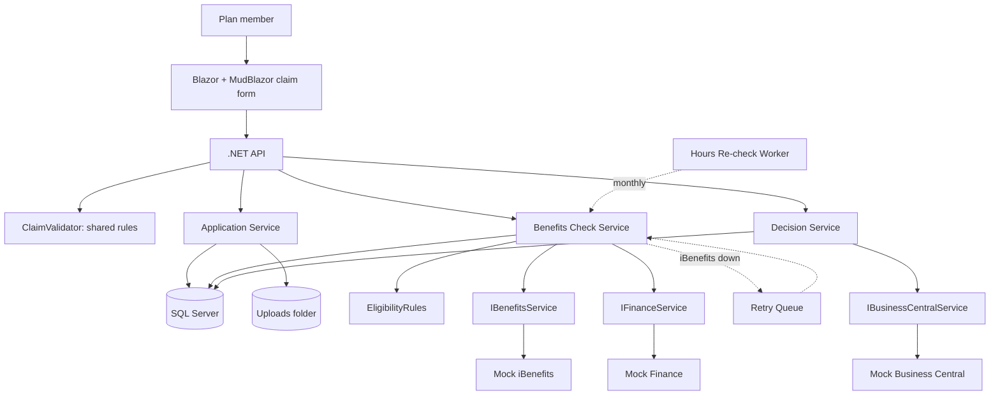
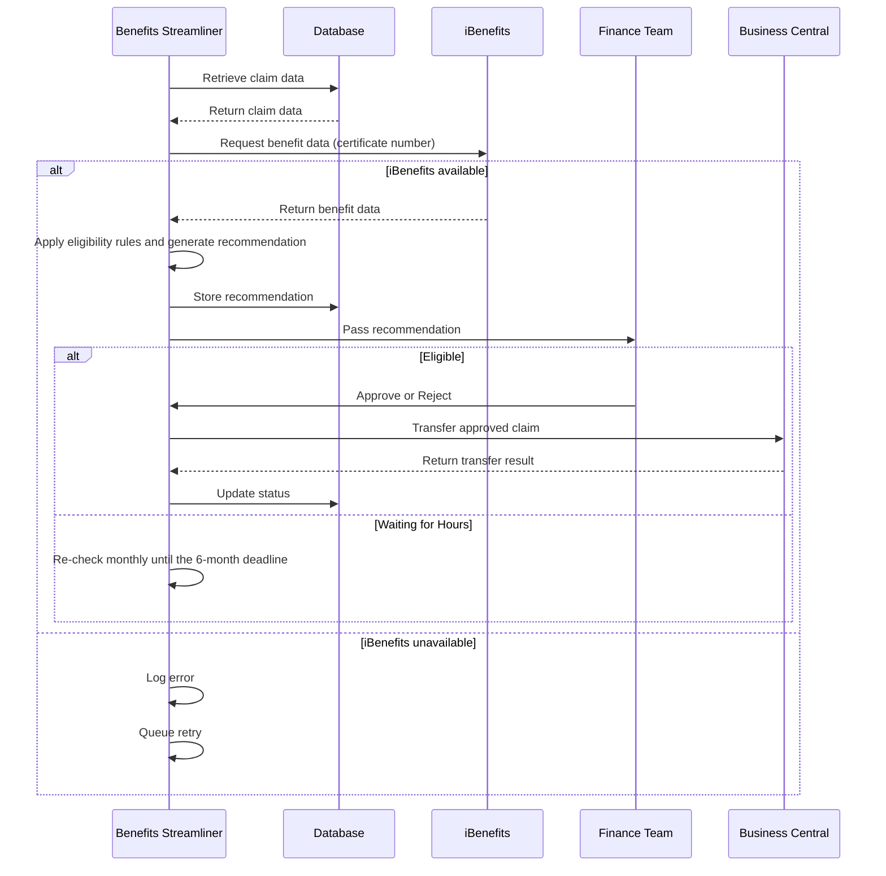

# Benefits Streamliner

A skinny vertical slice (proof of architecture) for the **OpenCircle Tuition Refund Program**. A plan member submits a claim form, the system checks it against iBenefits data using the program's eligibility rules, stores a recommendation, and passes it to Finance for a decision.

**Blazor UI → .NET API → SQL Server → iBenefits integration layer (mock) → Rules → Recommendation → Finance review → Business Central (mock)**

This is a prototype, not the production system. iBenefits, Finance, and Business Central are mocked on purpose. Each sits behind an interface so a real implementation can replace it later without touching the UI or the rules.

## What it does

1. The plan member fills out the **Tuition Refund Program Claim Form** (Blazor + MudBlazor), including a certificate/member number, and uploads their Marks and Proof of Completion. Ontario and British Columbia claims also upload a Proof of Payment.
2. The form validates the input (including a SIN checksum) and posts it, with the files, to the .NET API. The API validates again; the API is the authority.
3. The API checks for a duplicate claim (certificate number + tuition code), saves the claim and its documents, and returns a unique application ID (`APP-000001`, `APP-000002`, ...).
4. The system asks iBenefits (through `IBenefitsService`) for the plan member's benefit data and applies the eligibility rules.
5. The result is one of **Pending Finance Review** (eligible), **Waiting for Hours**, or **Denied**. The recommendation and its reason are stored and passed to `IFinanceService`.
6. Claims that are **Waiting for Hours** are re-checked monthly by a background worker, and denied if the hours don't arrive in time.
7. A Finance reviewer approves or rejects an eligible claim. Approval transfers it through `IBusinessCentralService`.
8. If iBenefits is unavailable, the error is logged, a retry is queued, and the user sees a clear status. The app does not crash.

## Eligibility rules

| Rule | Detail |
|---|---|
| Benefit status | iBenefits must report the benefit status as **Valid** |
| Return to work | The plan member must have returned to **full-time work** at an **OpenCircle member company**, and the return-to-work date can't be in the future |
| Hours | At least **150 hours**, or **300 hours** if the plan member was out of benefit **8 or more months** or started training right on hire |
| Hours not met | Status becomes **Waiting for Hours**, re-checked **monthly** |
| Hours deadline | **Denied** if the hours aren't in within **6 months of course completion** (the training end date) |
| Duplicates | A second claim with the same **certificate number + tuition code** is rejected |
| Provinces | **New Brunswick and Nova Scotia are excluded** |
| Proof of Payment | Required when the province is **Ontario or British Columbia** |

The rules live in `BenefitsStreamliner.Core/Rules/EligibilityRules.cs` and are covered by unit tests.

## Application statuses

```
Submitted → In Review → Pending Finance Review → Approved → Transferred
                │                  └────────────→ Denied (Finance rejects)
                ├→ Waiting for Hours ⟲ (monthly re-check) → Pending Finance Review
                │                                         └→ Denied (6-month deadline passed)
                ├→ Denied (benefit status, member company, full-time, or not found)
                └→ Error (iBenefits unavailable after 3 retries)
```

"Waiting for Hours" and "Denied" are the names from the current-state document. The other display names are working names, kept in one place (`BenefitsStreamliner.Core/Models/StatusNames.cs`) so they are easy to change.

## Tech stack

| Layer | Technology |
|---|---|
| UI | Blazor (Interactive Server) + MudBlazor |
| API | ASP.NET Core Web API (.NET 8) |
| Data access | Entity Framework Core 8 |
| Database | SQL Server / SQL Server Express (default). MySQL and SQLite are also supported |
| Tests | xUnit |

## Architecture



### Claim check and Finance decision (sequence)



## Solution structure

```
BenefitsStreamliner/
├── BenefitsStreamliner.Core/    Models, DTOs, interfaces, and the rules (validation, eligibility, SIN checksum, provinces)
├── BenefitsStreamliner.Api/     Controllers, services, background workers, EF Core DbContext, migrations
├── BenefitsStreamliner.Web/     Blazor claim form, MudBlazor layout, API client
└── BenefitsStreamliner.Tests/   Unit tests for the rules
```

Key pieces:

- `ClaimValidator`: one set of validation rules used by both the Blazor form (instant feedback) and the API (authoritative).
- `EligibilityRules`: the real tuition refund rules.
- `SinValidator`: 9 digits plus a Luhn checksum. Real SINs pass it.
- `IBenefitsService` / `MockBenefitsService`: the iBenefits abstraction and its mock.
- `IFinanceService` / `MockFinanceService`: the Finance hand-off and its mock (logs the recommendation).
- `IBusinessCentralService` / `MockBusinessCentralService`: the Business Central transfer and its mock.
- `BenefitsCheckService`: runs the check workflow and handles the iBenefits-unavailable path.
- `DecisionService`: applies the Finance decision and triggers the transfer.
- `RetryQueue` / `RetryWorker`: in-memory retry queue for iBenefits outages.
- `HoursRecheckWorker`: monthly re-check of Waiting for Hours claims.

## API endpoints

| Method | Route | Purpose |
|---|---|---|
| `POST` | `/api/applications` | Submit a claim. `multipart/form-data` with the claim fields plus files `documents` (Marks and Proof of Completion, 1 to 5 files) and `proofOfPayment` (required for ON and BC). Returns `{ "applicationId": "APP-000001" }` |
| `POST` | `/api/applications/{id}/check-benefits` | Run the iBenefits check and store the recommendation |
| `GET` | `/api/applications/{id}` | Current status, latest recommendation, next re-check date |
| `POST` | `/api/applications/{id}/decision` | Finance decision. Body: `{"decision":"Approve"}` or `{"decision":"Reject"}` |

Responses: `400` for validation errors (messages per field), `409` for a duplicate claim or a decision on a claim that isn't ready, `404` for an unknown ID. Error responses never include stack traces.

Uploads accept PDF, JPG, PNG, DOC and DOCX, up to 10 MB each.

## Prerequisites

- [.NET 8 SDK](https://dotnet.microsoft.com/download)
- SQL Server or SQL Server Express (or MySQL 8, or nothing if you use SQLite)
- The `dotnet-ef` tool: `dotnet tool install --global dotnet-ef`
- Git

Make sure the SQL Server service is running (for Express: `MSSQL$SQLEXPRESS`) before you run migrations or start the API.

## Setup

### 1. Clone

```bash
git clone https://github.com/xavion-git/BenefitsStreamliner.git
cd BenefitsStreamliner
```

### 2. Configure the database

Connection strings are **not** stored in the repo. Set yours with user-secrets from the API project:

```powershell
cd BenefitsStreamliner.Api
dotnet user-secrets init
dotnet user-secrets set "ConnectionStrings:Default" "Server=localhost\SQLEXPRESS;Database=BenefitsStreamliner;Trusted_Connection=True;TrustServerCertificate=True"
cd ..
```

Change `Server=` to match your instance name (the one you see when connecting in SSMS). **SqlServer is the default provider**, so no provider setting is needed.

**Other providers**

| Provider | Setting | Example connection string |
|---|---|---|
| SQL Server (default) | `Database:Provider` = `SqlServer` or unset | `Server=localhost\SQLEXPRESS;Database=BenefitsStreamliner;Trusted_Connection=True;TrustServerCertificate=True` |
| MySQL | `Database:Provider` = `MySql` | `Server=localhost;Port=3306;Database=benefits_streamliner;User=bs_user;Password=<your-password>` |
| SQLite | `Database:Provider` = `Sqlite` | `Data Source=benefits.db` |

Migrations are provider-specific. If you switch providers, delete `BenefitsStreamliner.Api/Migrations` and regenerate them (step 3).

### 3. Create the database

```powershell
dotnet ef migrations add InitialCreate --project BenefitsStreamliner.Api
dotnet ef database update --project BenefitsStreamliner.Api
```

This creates the `BenefitsStreamliner` database with the `Applications`, `ApplicationDocuments`, and `Recommendations` tables. (The API also applies pending migrations on startup in development.)

### 4. Run the API

```powershell
dotnet run --project BenefitsStreamliner.Api --urls http://localhost:5100
```

### 5. Run the Blazor app (second terminal)

```powershell
dotnet run --project BenefitsStreamliner.Web --urls http://localhost:5200
```

Open <http://localhost:5200>. The Web app finds the API through `ApiBaseUrl` in `BenefitsStreamliner.Web/appsettings.json` (default `http://localhost:5100/`). It must sit at the top level of the JSON file, not inside `Logging`.

### 6. Run the tests

```powershell
dotnet test
```

## Configuration reference

| Setting | Default | Purpose |
|---|---|---|
| `ConnectionStrings:Default` | none (required) | Database connection. Set via user-secrets or an environment variable |
| `Database:Provider` | `SqlServer` | `SqlServer`, `MySql`, or `Sqlite` |
| `MockBenefits:AlwaysUnavailable` | `false` | Makes every mock iBenefits call fail, to demo the retry limit |
| `HoursRecheck:PollSeconds` | `3600` | How often the worker looks for claims due a re-check |
| `HoursRecheck:DemoIntervalMinutes` | `0` | If above 0, re-check after this many minutes instead of monthly (for demos) |
| `Uploads:Path` | `Uploads` | Where uploaded documents are saved (relative to the API project) |
| `ApiBaseUrl` (Web) | `http://localhost:5100/` | Where the Blazor app finds the API |

For a fast demo of the monthly re-check:

```powershell
cd BenefitsStreamliner.Api
dotnet user-secrets set "HoursRecheck:PollSeconds" "15"
dotnet user-secrets set "HoursRecheck:DemoIntervalMinutes" "1"
cd ..
```

## The mock iBenefits integration

`MockBenefitsService` implements `IBenefitsService` and returns predictable data keyed by the certificate number. Lookups are case-insensitive.

| Certificate | iBenefits data | Result |
|---|---|---|
| `CERT-1001` | Valid, 320 hours | **Eligible** (Pending Finance Review) |
| `CERT-1002` | Valid, 100 hours, **+60 hours on every lookup** | **Waiting for Hours**, then **Eligible** on the re-check |
| `CERT-1003` | Valid, 200 hours, out of benefit 9 months (needs 300) | **Waiting for Hours**. If the training end date is over 6 months ago: **Denied** |
| `CERT-1004` | Valid, 250 hours, started training on hire (needs 300) | **Waiting for Hours** |
| `CERT-1005` | Benefit status Terminated | **Denied** |
| `CERT-1006` | Employer is not a member company | **Denied** |
| `CERT-9999` | Valid, 200 hours. **Unavailable on the first call only** | Retry queued, then **Eligible** |
| anything else | Not found in iBenefits | **Denied** |

`MockBenefits:AlwaysUnavailable = true` makes every call fail, so the retry queue gives up after 3 attempts and the claim is marked **Error**.

To replace the mock with the real system, write a `RealIBenefitsService : IBenefitsService` and change one line in `BenefitsStreamliner.Api/Program.cs`. Nothing else changes. Finance and Business Central swap the same way.

## Demo script

Use the valid test SIN **046 454 286** (it passes the checksum). Use a new **Tuition Code** for each claim, because a repeated certificate number + tuition code is rejected as a duplicate.

| # | Action | Expected result |
|---|---|---|
| 1 | Submit with `CERT-1001`, tuition code `TC-01`, Alberta, any past training dates, and a small PDF | Green confirmation with `APP-000001`, status **Pending Finance Review**, "Recommendation: Eligible" |
| 2 | Check SSMS: `SELECT * FROM Applications; SELECT * FROM Recommendations;` | Claim row with the status, recommendation row with `Eligible`, `SinLast3` = `286` |
| 3 | Check the API console | `Mock iBenefits returned data...` then `[FINANCE] Received recommendation...` |
| 4 | Click **Approve** | Status **Transferred**, and the console shows `[BUSINESS CENTRAL] Transferred approved application...` |
| 5 | Enter SIN `046 454 287` | The form rejects it (fails the checksum) |
| 6 | Choose Ontario as the mailing province | A **Proof of Payment** upload appears and is required |
| 7 | Resubmit `CERT-1001` with `TC-01` | Rejected as a duplicate, naming `APP-000001` |
| 8 | Submit `CERT-1002` (new tuition code) | **Waiting for Hours**, with a next re-check time |
| 9 | Wait for the re-check (about a minute with the demo settings), click **Refresh status** | **Pending Finance Review**, Eligible |
| 10 | Submit `CERT-1005` | **Denied**, benefit status is not Valid |
| 11 | Submit `CERT-9999` | "iBenefits is currently unavailable", console shows an error and a retry. After about 15 seconds, **Refresh status** shows Eligible |
| 12 | Submit `CERT-1003` with a training end date over 6 months ago | **Denied**, hours not received within 6 months |
| 13 | Click **Reject** on an eligible claim | Status **Denied**, and no Business Central log line |

## Security notes

- The **SIN is encrypted** (ASP.NET Core Data Protection) before it is stored. Only the last 3 digits are kept readable, and the SIN is never written to the logs. Data Protection keys are stored per Windows user by default, so for any real deployment configure shared, backed-up key storage. Without the keys, stored SINs can't be decrypted.
- The SIN is validated with a **Luhn checksum**, so it is a real check and not just a format check.
- **Uploaded documents** are saved under `Uploads/` with generated file names, and the original names are kept in the database. `Uploads/` is in `.gitignore`.
- No passwords, API keys, or connection strings are committed. Local settings live in user-secrets or environment variables, and `.gitignore` excludes `*.db` and `appsettings.Development.json`.
- Error responses to the UI are generic or contain only validation messages. Details go to the server logs only.
- File checks are by extension and size only. A production system would also scan uploaded files.

## Assumptions and open questions

These are the choices made where the requirements weren't specific. Confirm or change them with the team.

- **Status names:** only "Waiting for Hours" and "Denied" are confirmed from the current-state document. The others are in `StatusNames.cs`, marked `TO CONFIRM`.
- **Tuition code** isn't on the paper form. It was added as a required field so the duplicate check (certificate number + tuition code) can work. If it should come from iBenefits or a lookup, this changes.
- **Extra iBenefits fields** (months out of benefit, started training on hire, employer is a member, full-time) were added to the mock, because the 300-hour rule and the member-company rule need them.
- **Province rule:** Proof of Payment keys off the plan member's mailing province. To use the company province, change `ClaimValidator.ProofOfPaymentRequired`. The territories are included in the province list.
- **Course completion** is taken as the training end date ("To"), which starts the 6-month hours window.
- **Duplicates:** a Denied claim still blocks a re-claim for the same certificate number and tuition code.
- **Finance review** (Approve or Reject) applies to eligible claims only.
- **Sequence difference:** the team's sequence diagram routes the iBenefits data request through the Finance Team, while the written spec calls iBenefits directly. This prototype calls it directly. The `IBenefitsService` interface keeps both options open.

## Scope and limitations

Out of scope for the prototype:

- Real iBenefits, Finance, and Business Central integrations (all three are mocks)
- Authentication and authorization (anyone can click Approve or Reject)
- A durable retry queue (the in-memory queue is lost when the API restarts; Waiting for Hours claims are not affected, because they are re-checked from the database)
- Document storage beyond the local disk, and virus scanning
- Storing the raw iBenefits response (only the recommendation is kept)

## Third-party libraries and licenses

| Library | Purpose | License |
|---|---|---|
| [MudBlazor](https://mudblazor.com) | UI components | MIT |
| [Entity Framework Core](https://github.com/dotnet/efcore) | Data access | MIT |
| [Pomelo.EntityFrameworkCore.MySql](https://github.com/PomeloFoundation/Pomelo.EntityFrameworkCore.MySql) | MySQL provider | MIT |
| [xUnit](https://xunit.net) | Testing | Apache 2.0 |

SQL Server, SQL Server Express, and MySQL are used as external database services and are not redistributed in this repository. Their licenses are set by their vendors. Check each project's repository or NuGet page to confirm license details before publishing.
