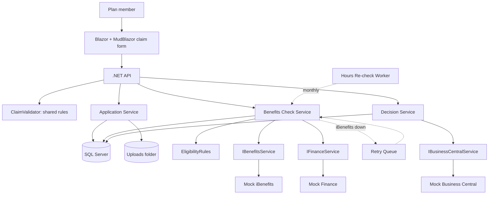
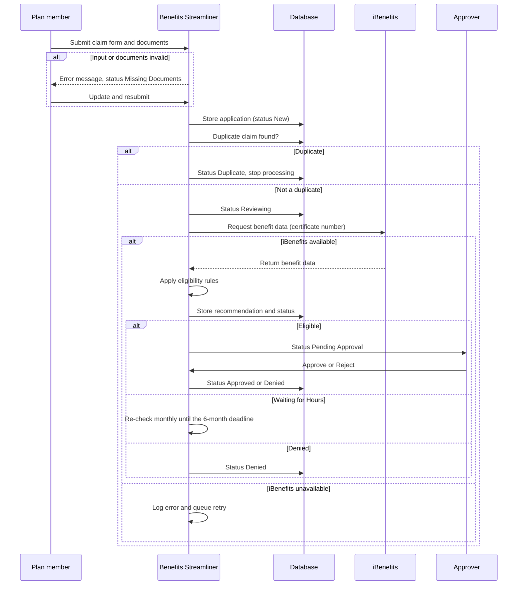

# Benefits Streamliner

A skinny vertical slice (proof of architecture) for the **OpenCircle Tuition Refund Program**. A plan member submits a claim form, the system checks it for duplicates and against iBenefits data using the program's eligibility rules, stores a recommendation, and passes eligible claims on for approval.

**Blazor UI → .NET API → SQL Server → duplicate check → iBenefits integration layer (mock) → eligibility rules → recommendation → approval → Business Central (mock)**

This is a prototype, not the production system. iBenefits, Finance and Business Central are mocked on purpose. Each sits behind an interface so a real implementation can replace it later without touching the UI or the rules. The prototype covers the **plan member** and **system** lanes of the future-state flow, plus a thin stand-in for the **Accounting** lane (see [Scope and limitations](#scope-and-limitations)).

## What it does

1. The plan member fills out the **Tuition Refund Program Claim Form** (Blazor + MudBlazor) and uploads their Marks and Proof of Completion. If the training was completed in Ontario or British Columbia, they also upload a Proof of Payment.
2. The form validates the input (including a SIN checksum). If anything is wrong it shows the problems with the status **Missing Documents**, and the plan member fixes them and resubmits. Nothing is stored yet.
3. The form posts the claim, with its files, to the .NET API. The API validates again; the API is the authority.
4. The API stores the claim with the status **New** and returns a unique application ID (`APP-000001`, `APP-000002`, ...).
5. The system checks for a **duplicate** claim. A duplicate is marked **Duplicate** and processing stops.
6. Otherwise the status becomes **Reviewing**. The system asks iBenefits (through `IBenefitsService`) for the plan member's data and applies the eligibility rules.
7. The result is **Pending Approval** (eligible), **Waiting for Hours**, or **Denied**. The recommendation and its reason are stored and passed to `IFinanceService`.
8. Claims that are **Waiting for Hours** are re-checked monthly by a background worker, and denied if the hours don't arrive in time.
9. A reviewer approves or rejects a claim that is Pending Approval. Approval is **Approved** and hands the claim to `IBusinessCentralService`. Rejection is **Denied**.
10. If iBenefits is unavailable, the error is logged, a retry is queued, and the user sees a clear status. The app does not crash.

## The claim form

The form has six numbered sections, followed by the important-information notes:

| Section | Fields |
|---|---|
| 1. Employee information | First name, last name, Social Insurance Number (three boxes), phone, email, mailing address, city, province, postal code, **OpenCircle member or certificate number** |
| 2. Employer information | Company name, address, city, province, postal code |
| 3. Training | Trade or occupation, year (1st to 4th), **province where the training was completed**, training start date, training end date, returned-to-work date |
| 4. Refund payment | Paid to the Employer or the Employee |
| 5. Supporting documents | Marks and Proof of Completion (always), Proof of Payment (Ontario and BC only) |
| 6. Declaration and signatures | Terms checkbox, employee signature and date, employer representative name, position, signature and date |

Form rules, enforced by the Blazor form (instant feedback) and again by the API:

- **Certificate number** is required and must be digits only (up to 15). Accounting uses it to find the plan member's record.
- **Social Insurance Number** must be 9 digits and pass the **Luhn checksum**. Real SINs pass it, so this is a real validation, not just a format check.
- **Training province** drives two rules: Ontario and BC require a **Proof of Payment** upload, and training completed in **New Brunswick or Nova Scotia is not covered**. The mailing and company province lists include all 13 provinces and territories and are not restricted.
- **Dates** can't be in the future. The end date can't be before the start date, and the return-to-work date can't be before the end of training. A warning appears if training ended more than six months ago (the claim can still be submitted for review).
- **Signatures** must match: the employee signature must match the first and last name, and the representative signature must match the representative name. The terms checkbox is required.
- **Uploads** accept PDF, JPG, PNG, DOC and DOCX, up to 10 MB each and 10 files in total.
- Postal codes, emails, phone numbers (10 digits) and names are checked for a valid format.
- A hidden spam-trap field makes bots look like they succeeded without sending anything.

## Eligibility rules

| Rule | Detail |
|---|---|
| Duplicate claim | A claim with the same **certificate number** as an earlier claim is marked **Duplicate** and processing stops |
| Benefit status | iBenefits must report the benefit status as **Valid** |
| Return to work | The plan member must have returned to **full-time work** at an **OpenCircle member company** |
| Hours | At least **150 hours**, or **300 hours** if the plan member was out of benefit **8 or more months** or started training right on hire |
| Hours not met | Status becomes **Waiting for Hours**, re-checked **monthly** |
| Hours deadline | **Denied** if the hours aren't in within **6 months of course completion** (the training end date) |

The rules live in `BenefitsStreamliner.Core/Rules/EligibilityRules.cs` and are covered by unit tests.

## Application statuses

These are the agreed names from the Tuition Refund future-state flow.

```
New ──→ Duplicate                       (same certificate number as an earlier claim; processing stops)
 │
 └──→ Reviewing ──→ Pending Approval ──→ Approved ──→ (Cheque Printed: Accounting phase)
          │                  └─────────→ Denied      (rejected at approval)
          ├──→ Waiting for Hours ⟲ monthly re-check ──→ Pending Approval
          │                                          └─→ Denied  (6-month deadline passed)
          ├──→ Denied     (benefit status, member company, full-time work, or not found in iBenefits)
          └──→ Error      (iBenefits unavailable after 3 retries)
```

- **Missing Documents** is shown on the form when validation fails. It is never stored.
- **Cheque Printed** is reserved for the Accounting phase and is not used by the prototype yet.
- **Error** is not in the flow diagram. It covers technical failures only.

Display names live in one place, `BenefitsStreamliner.Core/Models/StatusNames.cs`.

## Tech stack

| Layer | Technology |
|---|---|
| UI | Blazor (Interactive Server) + MudBlazor |
| API | ASP.NET Core Web API (.NET 8) |
| Data access | Entity Framework Core 8 |
| Database | SQL Server / SQL Server Express (default). MySQL and SQLite are also supported |
| Tests | xUnit |

## Architecture



### Claim processing (sequence)



## Solution structure

```
BenefitsStreamliner/
├── BenefitsStreamliner.Core/    Models, DTOs, interfaces, and the rules (validation, eligibility, SIN checksum, provinces, status names)
├── BenefitsStreamliner.Api/     Controllers, services, background workers, EF Core DbContext, migrations
├── BenefitsStreamliner.Web/     Blazor claim form, MudBlazor layout, API client
└── BenefitsStreamliner.Tests/   Unit tests for the rules
```

Key pieces:

- `ClaimValidator`: one set of validation rules used by both the Blazor form and the API.
- `EligibilityRules`: the tuition refund eligibility rules.
- `SinValidator`: 9 digits plus a Luhn checksum.
- `Provinces`: the 13 provinces and territories, the NB/NS exclusion, and the Ontario/BC Proof of Payment rule.
- `StatusNames`: display names for the agreed statuses.
- `ApplicationService`: stores a validated claim and its uploads, encrypts the SIN.
- `BenefitsCheckService`: duplicate check, iBenefits call, rules, recommendation, and the iBenefits-unavailable path.
- `DecisionService`: the approval step and the Business Central hand-off.
- `IBenefitsService` / `MockBenefitsService`, `IFinanceService` / `MockFinanceService`, `IBusinessCentralService` / `MockBusinessCentralService`: the three integrations and their mocks.
- `RetryQueue` / `RetryWorker`: in-memory retry queue for iBenefits outages.
- `HoursRecheckWorker`: monthly re-check of Waiting for Hours claims.

## API endpoints

| Method | Route | Purpose |
|---|---|---|
| `POST` | `/api/applications` | Submit a claim. `multipart/form-data` with the claim fields plus files `completionDocs` (Marks and Proof of Completion) and `paymentDocs` (Proof of Payment, only counted when the training province is ON or BC). Returns `{ "applicationId": "APP-000001" }` and stores the claim as **New** |
| `POST` | `/api/applications/{id}/check-benefits` | Run the duplicate check, the iBenefits check and the rules, and store the recommendation. The Blazor form calls this automatically after submitting |
| `GET` | `/api/applications/{id}` | Current status, latest recommendation, next re-check date |
| `POST` | `/api/applications/{id}/decision` | Approval decision. Body: `{"decision":"Approve"}` or `{"decision":"Reject"}` |

Responses: `400` for validation errors (a message per field), `409` for a decision on a claim that isn't Pending Approval, `404` for an unknown ID. A duplicate claim is **not** an error response: it is stored and shows the status Duplicate. Error responses never include stack traces.

## Prerequisites

- [.NET 8 SDK](https://dotnet.microsoft.com/download)
- SQL Server or SQL Server Express (or MySQL 8, or nothing if you use SQLite)
- The `dotnet-ef` tool: `dotnet tool install --global dotnet-ef`
- Git

Make sure the SQL Server service is running (for Express: `MSSQL$SQLEXPRESS`) before you run migrations or start the API.

## Setup

### 1. Clone

```bash
git clone https://github.com/xavion-git/BenefitsStreamliner.git
cd BenefitsStreamliner
```

### 2. Configure the database

Connection strings are **not** stored in the repo. Set yours with user-secrets from the API project:

```powershell
cd BenefitsStreamliner.Api
dotnet user-secrets init
dotnet user-secrets set "ConnectionStrings:Default" "Server=localhost\SQLEXPRESS;Database=BenefitsStreamliner;Trusted_Connection=True;TrustServerCertificate=True"
cd ..
```

Change `Server=` to match your instance name (the one you see when connecting in SSMS). **SqlServer is the default provider**, so no provider setting is needed.

**Other providers**

| Provider | Setting | Example connection string |
|---|---|---|
| SQL Server (default) | `Database:Provider` = `SqlServer` or unset | `Server=localhost\SQLEXPRESS;Database=BenefitsStreamliner;Trusted_Connection=True;TrustServerCertificate=True` |
| MySQL | `Database:Provider` = `MySql` | `Server=localhost;Port=3306;Database=benefits_streamliner;User=bs_user;Password=<your-password>` |
| SQLite | `Database:Provider` = `Sqlite` | `Data Source=benefits.db` |

Migrations are provider-specific. If you switch providers, delete `BenefitsStreamliner.Api/Migrations` and regenerate them (step 3).

### 3. Create the database

```powershell
dotnet ef migrations add InitialCreate --project BenefitsStreamliner.Api
dotnet ef database update --project BenefitsStreamliner.Api
```

This creates the `BenefitsStreamliner` database with the `Applications`, `ApplicationDocuments` and `Recommendations` tables. (The API also applies pending migrations on startup in development.)

If the data model changes during development, drop the database first and regenerate the migration:

```powershell
dotnet ef database drop --project BenefitsStreamliner.Api --force
Remove-Item -Recurse -Force BenefitsStreamliner.Api\Migrations
dotnet ef migrations add InitialCreate --project BenefitsStreamliner.Api
dotnet ef database update --project BenefitsStreamliner.Api
```

### 4. Run the API

```powershell
dotnet run --project BenefitsStreamliner.Api --urls http://localhost:5100
```

### 5. Run the Blazor app (second terminal)

```powershell
dotnet run --project BenefitsStreamliner.Web --urls http://localhost:5200
```

Open <http://localhost:5200>. The Web app finds the API through `ApiBaseUrl` in `BenefitsStreamliner.Web/appsettings.json` (default `http://localhost:5100/`). It must sit at the top level of the JSON file, not inside `Logging`.

### 6. Run the tests

```powershell
dotnet test
```

## Configuration reference

| Setting | Default | Purpose |
|---|---|---|
| `ConnectionStrings:Default` | none (required) | Database connection. Set via user-secrets or an environment variable |
| `Database:Provider` | `SqlServer` | `SqlServer`, `MySql`, or `Sqlite` |
| `MockBenefits:AlwaysUnavailable` | `false` | Makes every mock iBenefits call fail, to demo the retry limit |
| `HoursRecheck:PollSeconds` | `3600` | How often the worker looks for claims due a re-check |
| `HoursRecheck:DemoIntervalMinutes` | `0` | If above 0, re-check after this many minutes instead of monthly (for demos) |
| `Uploads:Path` | `Uploads` | Where uploaded documents are saved (relative to the API project) |
| `ApiBaseUrl` (Web) | `http://localhost:5100/` | Where the Blazor app finds the API |

For a fast demo of the monthly re-check:

```powershell
cd BenefitsStreamliner.Api
dotnet user-secrets set "HoursRecheck:PollSeconds" "15"
dotnet user-secrets set "HoursRecheck:DemoIntervalMinutes" "1"
cd ..
```

## The mock iBenefits integration

`MockBenefitsService` implements `IBenefitsService` and returns predictable data keyed by the certificate number.

| Certificate | iBenefits data | Result |
|---|---|---|
| `1001` | Valid, 320 hours | **Pending Approval** (eligible) |
| `1002` | Valid, 100 hours, **+60 hours on every lookup** | **Waiting for Hours**, then **Pending Approval** on the re-check |
| `1003` | Valid, 200 hours, out of benefit 9 months (needs 300) | **Waiting for Hours**. If the training end date is over 6 months ago: **Denied** |
| `1004` | Valid, 250 hours, started training on hire (needs 300) | **Waiting for Hours** |
| `1005` | Benefit status Terminated | **Denied** |
| `1006` | Employer is not a member company | **Denied** |
| `9999` | Valid, 200 hours. **Unavailable on the first call only** | Retry queued, then **Pending Approval** |
| anything else | Not found in iBenefits | **Denied** |

`MockBenefits:AlwaysUnavailable = true` makes every call fail, so the retry queue gives up after 3 attempts and the claim is marked **Error**.

To replace the mock with the real system, write a `RealIBenefitsService : IBenefitsService` and change one line in `BenefitsStreamliner.Api/Program.cs`. Nothing else changes. Finance and Business Central swap the same way.

## Demo script

**Test values for the form.** Use the valid test SIN **046 454 286** (it passes the checksum), and fill the rest with any realistic values: phone `7805551234`, postal code `T5L 4H5`, training dates in the past (end date within the last 6 months, return to work on or after the end date), and any small PDF for Marks and Proof of Completion. Tick the terms box, and type your full name as the employee signature and the representative's full name as the representative signature (they must match the names above them).

Because a repeated certificate number is a duplicate, **use a different certificate number for each scenario below**.

| # | Action | Expected result |
|---|---|---|
| 1 | Submit with certificate `1001` and training province Alberta | Confirmation with `APP-000001`, status **Pending Approval**, "Recommendation: Eligible" |
| 2 | Check SSMS: `SELECT * FROM Applications; SELECT * FROM Recommendations;` | Claim row with the status, recommendation row with `Eligible`, `SinLast3` = `286` |
| 3 | Check the API console | `Mock iBenefits returned data...` then `[FINANCE] Received recommendation...` |
| 4 | Click **Approve** | Status **Approved**, and the console shows `[BUSINESS CENTRAL] Transferred approved application...` |
| 5 | Submit again with certificate `1001` | Status **Duplicate**, naming `APP-000001`, and no recommendation is created |
| 6 | Enter SIN `046 454 287` and submit | Banner "Status: Missing Documents" with the SIN message, nothing stored |
| 7 | Choose Ontario as the training province | An info notice appears and a **Proof of Payment** upload box is required |
| 8 | Choose New Brunswick as the training province and submit | Rejected: training in NB or NS is not covered |
| 9 | Type a signature that doesn't match the name and submit | Rejected: the signature must match the name |
| 10 | Submit certificate `1002` | **Waiting for Hours**, with a next re-check time |
| 11 | Wait for the re-check (about a minute with the demo settings), click **Refresh status** | **Pending Approval**, Eligible. Click **Reject** to see **Denied** |
| 12 | Submit certificate `1005` | **Denied**, benefit status is not Valid |
| 13 | Submit certificate `9999` | "iBenefits is currently unavailable", the console shows an error and a retry. After about 15 seconds, **Refresh status** shows Pending Approval |
| 14 | Enter a training end date over 6 months ago, then submit certificate `1003` | A warning appears on the form, and the claim is **Denied** for not receiving hours within 6 months |

**Resetting the demo data** (SSMS):

```sql
USE BenefitsStreamliner;
DELETE FROM Recommendations;
DELETE FROM ApplicationDocuments;
DELETE FROM Applications;
DBCC CHECKIDENT ('Applications', RESEED, 0);
```

## Security notes

- The **SIN is encrypted** (ASP.NET Core Data Protection) before it is stored. Only the last 3 digits are kept readable, and the SIN is never written to the logs. Data Protection keys are stored per Windows user by default, so for any real deployment configure shared, backed-up key storage. Without the keys, stored SINs can't be decrypted.
- The SIN is validated with a **Luhn checksum**, so it is a real check and not just a format check.
- **Uploaded documents** are saved under `Uploads/` with generated file names, and the original names are kept in the database. `Uploads/` is in `.gitignore`.
- No passwords, API keys, or connection strings are committed. Local settings live in user-secrets or environment variables, and `.gitignore` excludes `*.db` and `appsettings.Development.json`.
- Error responses to the UI are generic or contain only validation messages. Details go to the server logs only.
- File checks are by extension and size only. A production system would also scan uploaded files.

## Assumptions and open questions

These are the choices made where the requirements weren't specific. Confirm or change them with the team.

- **Duplicates:** the certificate number alone identifies a claim, because there is no tuition code on the form. This means a later claim by the same plan member (for example, the next training year) would be marked Duplicate. The flow defines a duplicate as the same plan member and course; adding trade and year to the duplicate query in `BenefitsCheckService` would model that.
- **Denied originals:** a Denied claim still counts as the original when checking for duplicates.
- **Certificate number format:** the form requires digits only (up to 15). The real format may differ.
- **Extra iBenefits fields:** months out of benefit, started training on hire, employer is a member, and full-time were added to the mock, because the 300-hour rule and the member-company rule need them.
- **Course completion** is taken as the training end date, which starts the 6-month hours window. The form's separate warning (claim submitted more than six months after the Proof of Completion date) is advisory only.
- **Not found in iBenefits** is treated as Denied.
- **iBenefits vs MVOS:** the flow diagram names the validation system "MVOS". The prototype treats it as the same system as iBenefits.
- **Sequence difference:** an earlier team sequence diagram routed the iBenefits request through the Finance Team, while the written spec and the future-state flow call the validation system directly. This prototype calls it directly, and `IBenefitsService` keeps both options open.
- **Approval** is a single Approve or Reject step, followed by a mock Business Central hand-off. The flow's real Accounting steps are not built.

## Scope and limitations

Out of scope for the prototype:

- The **Accounting lane** of the flow: Accounting review, refund amount (weeks × standard rate for AB, SK and MB; receipts for ON and BC), vendor record and purchase quote, first and second approval, and cheque printing (**Cheque Printed**)
- **Notifications** to the plan member (the denied letter and the notice after the cheque is printed). The status is only shown on the page
- Real iBenefits, Finance and Business Central integrations (all three are mocks)
- Authentication and authorization (anyone can click Approve or Reject)
- A durable retry queue (the in-memory queue is lost when the API restarts; Waiting for Hours claims are not affected, because they are re-checked from the database)
- Document storage beyond the local disk, and virus scanning
- Storing the raw iBenefits response (only the recommendation is kept)
- SIN auto-advance and paste, and phone and postal auto-formatting on the form (the server tidies phone and postal values instead)

## Third-party libraries and licenses

| Library | Purpose | License |
|---|---|---|
| [MudBlazor](https://mudblazor.com) | UI components | MIT |
| [Entity Framework Core](https://github.com/dotnet/efcore) | Data access | MIT |
| [Pomelo.EntityFrameworkCore.MySql](https://github.com/PomeloFoundation/Pomelo.EntityFrameworkCore.MySql) | MySQL provider | MIT |
| [xUnit](https://xunit.net) | Testing | Apache 2.0 |

SQL Server, SQL Server Express, and MySQL are used as external database services and are not redistributed in this repository. Their licenses are set by their vendors. Check each project's repository or NuGet page to confirm license details before publishing.
